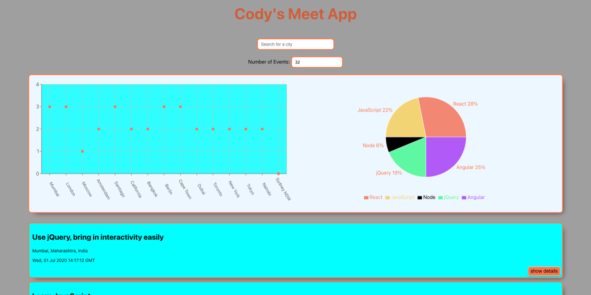

# Meet

A serverless progressive web app (PWA) built with React and test-driven
development. It shows upcoming tech events from the Google Calendar API, lets you
filter them by city, and charts where events are happening and what topics they
cover.

**Live demo:** https://cody-ayers.github.io/meet/



## Features

- **Filter by city** with autocomplete suggestions
- **Show or hide event details** for each event
- **Choose how many events** to display
- **Charts** (Recharts): a scatter chart of events per city and a pie chart of event topics
- **Works offline:** a service worker (Workbox) caches the app and the last loaded events, with a warning when you're offline
- **Installable** on a phone or desktop home screen
- **Alerts** for invalid input and offline mode

## How it works

The React app signs the user in with Google through three AWS Lambda functions
(Serverless Framework) in `auth-server/`:

1. `getAuthURL` returns the Google OAuth consent screen URL
2. `getAccessToken` swaps the code from Google for an access token
3. `getCalendarEvents` uses that token to load events from the Google Calendar API

## Testing

The app was built test-first:

- **Unit and integration tests** with Jest and React Testing Library (`src/__tests__/`)
- **Behavior-driven tests** written as Gherkin user stories with jest-cucumber (`src/features/`): filtering events by city, showing and hiding event details, and choosing the number of events
- **End-to-end tests** with Puppeteer

```bash
npm test
```

## Tech stack

| Area | Tools |
|---|---|
| Frontend | React 18, Create React App |
| Charts | Recharts |
| PWA | Workbox service worker, web app manifest |
| Backend | AWS Lambda, Serverless Framework, Google OAuth 2.0, Google Calendar API |
| Testing | Jest, React Testing Library, jest-cucumber, Puppeteer |
| Monitoring | Atatus |
| Deployment | GitHub Pages |

## Running locally

```bash
git clone https://github.com/Cody-Ayers/meet.git
cd meet
npm install
npm start
```

Running on `localhost` uses the sample events in `src/mock-data.js`, so no
Google sign-in is needed.
